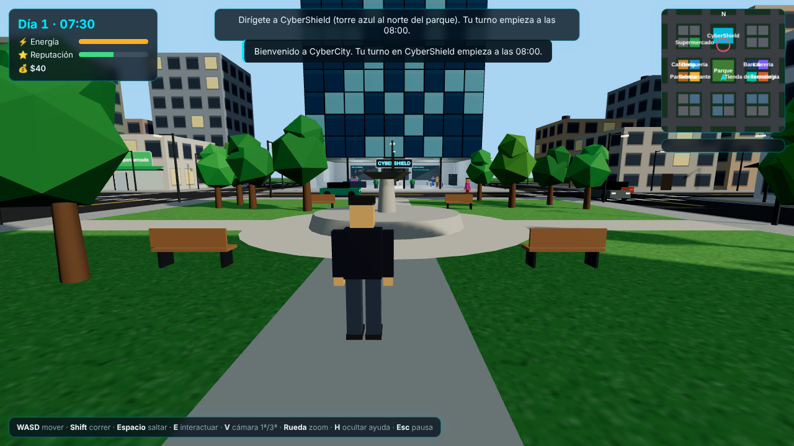
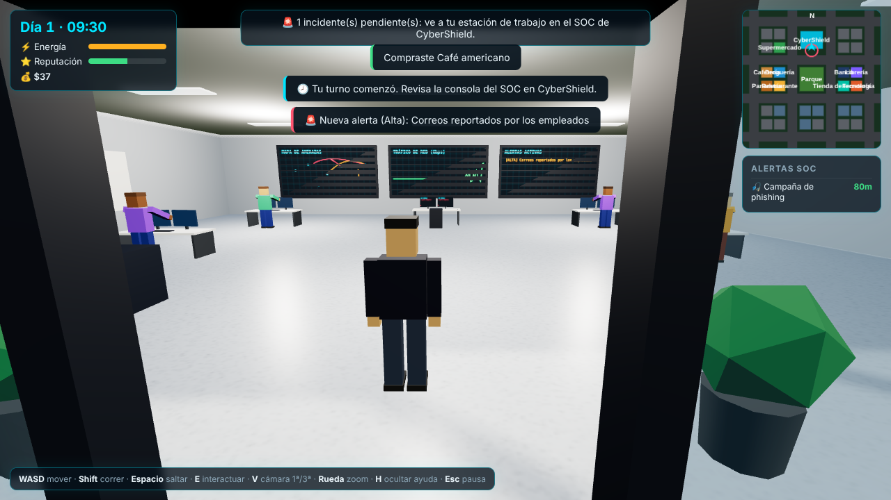
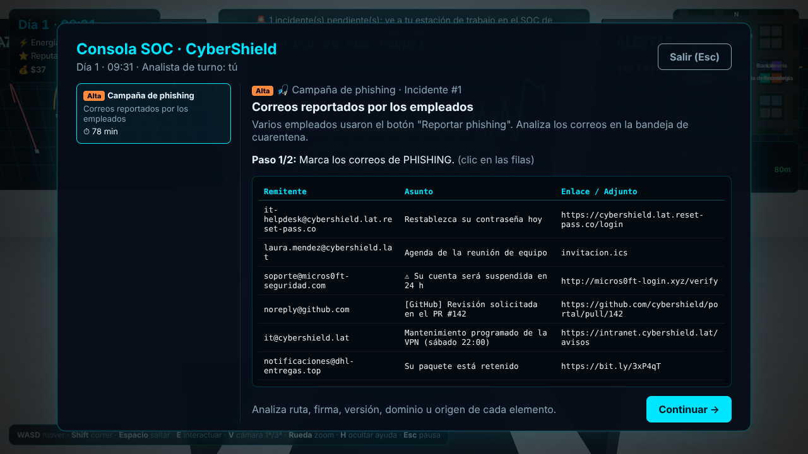

# 🛡️ CyberCity

Juego 3D en **primera y tercera persona** donde eres **Ingeniero(a) en Ciberseguridad**. Recorres una mini ciudad con
supermercado, cafetería, droguería, panadería, banco, librería y más. Tu trabajo está en **CyberShield**, donde durante la
jornada atiendes incidentes desde la consola del SOC: buscas vulnerabilidades, identificas malware, detienes intrusos y
desarmas campañas de phishing.

> Estado: **prototipo jugable v0.1** (base técnica + bucle de juego completo). Ver [`docs/GDD.md`](docs/GDD.md) para el diseño y la hoja de ruta.

| Ciudad | Oficina SOC | Consola de incidentes |
| --- | --- | --- |
|  |  |  |

## Cómo ejecutarlo

Requisitos: Node.js 20+.

```bash
npm install
npm run dev        # abre http://localhost:5173
npm run build      # typecheck + build de producción en dist/
npm run preview    # sirve el build
```

### Controles

| Tecla | Acción |
| --- | --- |
| `W A S D` / flechas | Moverse |
| Ratón | Mirar |
| `Shift` | Correr |
| `Espacio` | Saltar |
| `E` | Interactuar (negocios, recepción, estación de trabajo) |
| `V` | Cambiar cámara 1ª / 3ª persona |
| Rueda | Zoom de la cámara en 3ª persona |
| `H` | Mostrar/ocultar ayuda |
| `Esc` | Pausa / cerrar ventanas |

### Parámetros de depuración (URL)

- `?nolock` — juega sin Pointer Lock (útil para pruebas automatizadas).
- `?time=540` — empieza a una hora concreta (minutos desde las 00:00; 540 = 09:00).
- En modo desarrollo el objeto `window.__game` expone el estado del juego.

## Bucle de juego

1. Empiezas a las 07:30 en el parque central. Tu turno en CyberShield comienza a las **08:00**.
2. Durante la jornada llegan **alertas** (notificación + panel lateral + marcador en el minimapa), cada una con un plazo según su severidad.
3. En tu **estación de trabajo** del SOC resuelves cada incidente en dos pasos:
   1. Marcar los elementos maliciosos/vulnerables (servicios, procesos, eventos de log, correos).
   2. Elegir la respuesta correcta (contención, erradicación, etc.).
4. Recibes **puntaje, pago y reputación**, con la explicación de cada elemento (aprendizaje real).
5. La **energía** baja con el tiempo y el trabajo: recupérala en Café Byte, MegaMarket, la panadería o el restaurante.
6. A las 17:00 ves el resumen del día. Si la reputación llega a 0, te despiden.

## Tecnología

| Capa | Elección | Por qué |
| --- | --- | --- |
| Motor 3D | [Three.js](https://threejs.org) | Estándar de facto para 3D en la web, enorme comunidad, control total. |
| Lenguaje | TypeScript (estricto) | Tipos para un proyecto que va a crecer. |
| Bundler | Vite | Recarga instantánea y build optimizado. |
| UI | HTML/CSS sobre el canvas | Ideal para las consolas, tablas y terminales de los retos de ciberseguridad. |

Se eligió **web** porque el juego se puede compartir con un enlace (sin instalar), corre en cualquier PC y la parte
de ciberseguridad (terminales, logs, correos) se construye mucho mejor con HTML que dentro de un motor. Las alternativas
(Unity, Godot, Unreal) y cuándo convendría migrar están analizadas en el GDD.

## Estructura

```
src/
  config.ts            Parámetros de balance y trazado de la ciudad
  main.ts              Punto de entrada
  core/                Game (orquestador), Input, GameState (guardado), RNG
  world/               Ciudad, edificios, negocios, sede CyberShield, props, tráfico y peatones
  player/              Controlador del jugador y cámaras 1ª/3ª persona
  cyber/               Tipos de incidentes, generadores de retos y jornada laboral
  data/                Negocios y sus productos
  ui/                  HUD, minimapa, consola SOC, tiendas y resumen del día
docs/GDD.md            Documento de diseño y hoja de ruta
```

Todo el contenido 3D es **procedural** (geometrías y texturas generadas en canvas), así que el prototipo no depende
de assets externos. El siguiente salto visual es reemplazarlo por modelos glTF (ver hoja de ruta).
