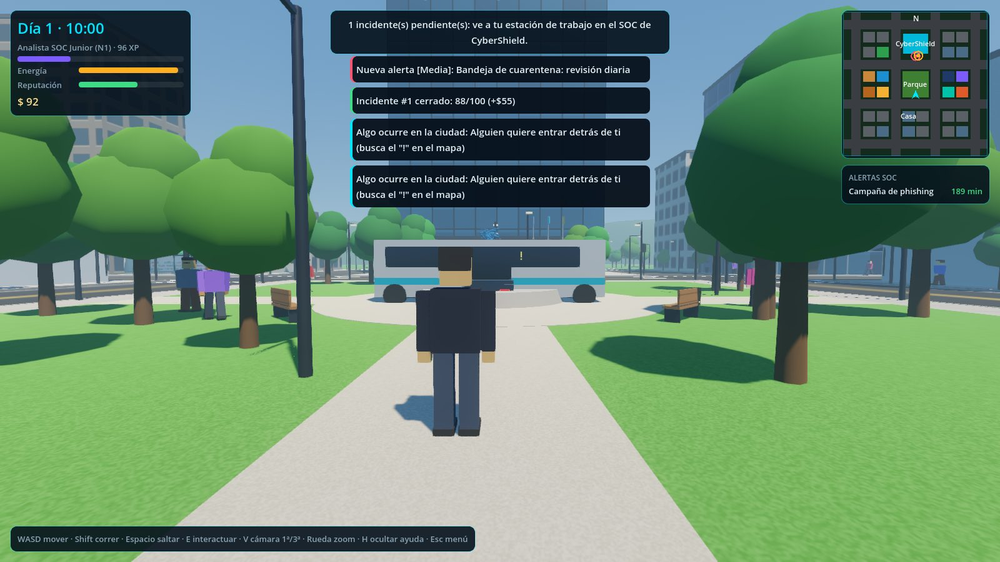
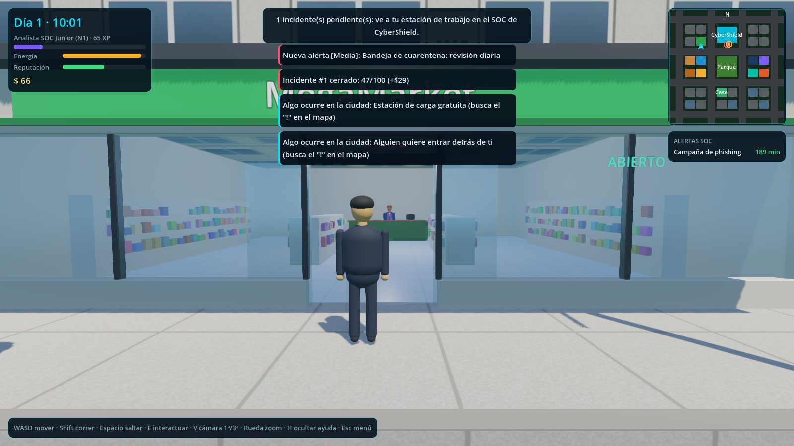
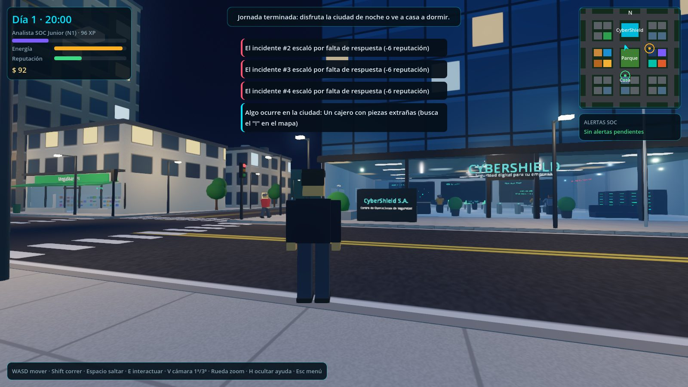
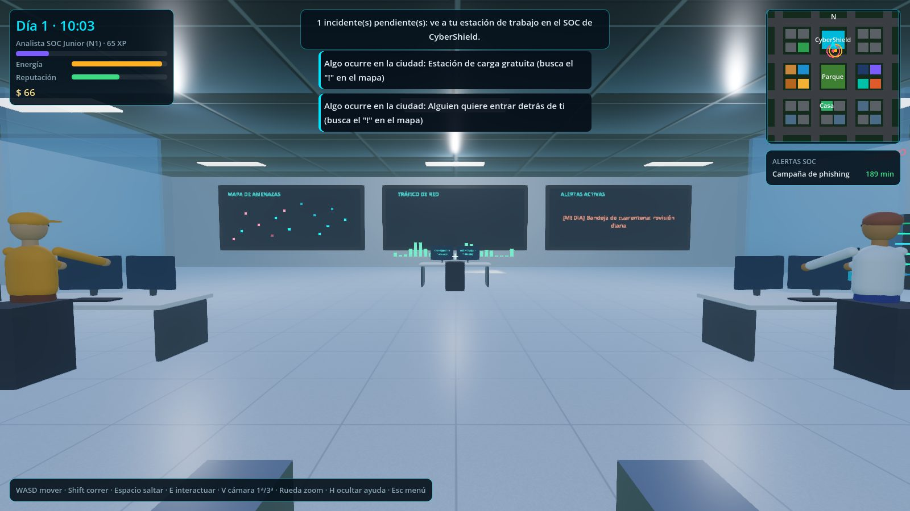
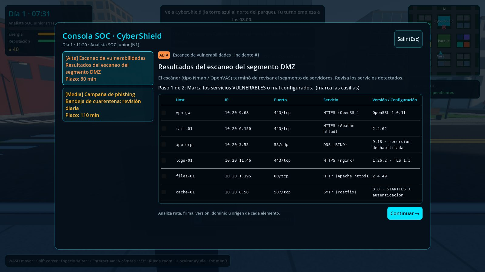
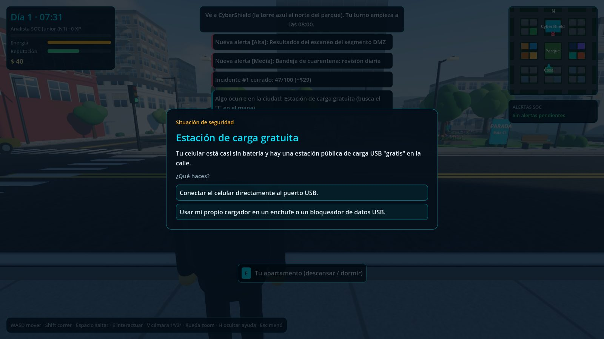
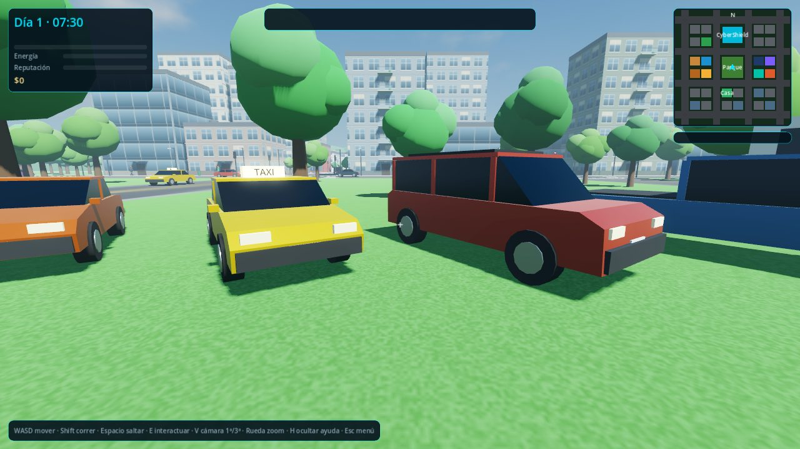
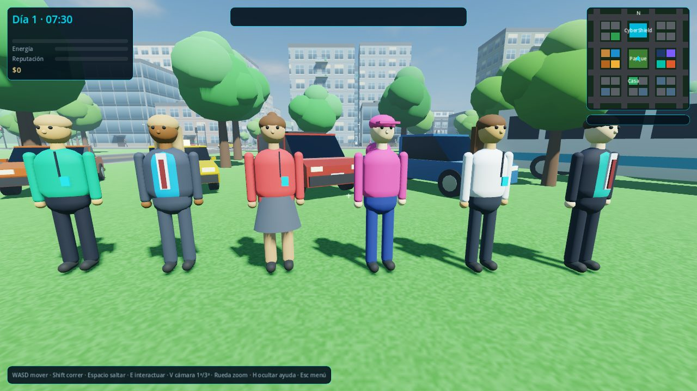
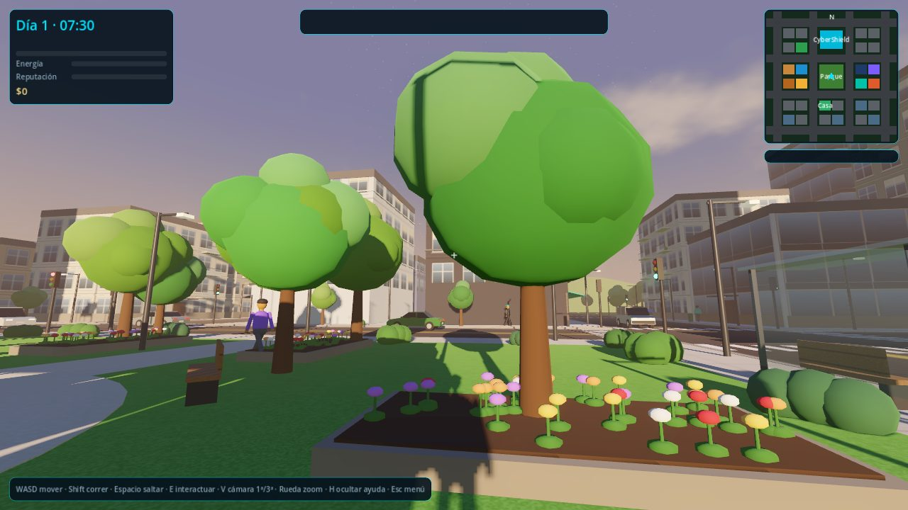

# CyberCity (Godot 4)

Juego 3D en **primera y tercera persona** donde eres **Ingeniero(a) en Ciberseguridad**. Recorres una ciudad con
supermercado, cafetería, droguería, panadería, restaurante, banco, librería, tienda de tecnología y ferretería, **entras
a los negocios**, y trabajas en **CyberShield**: desde la consola del SOC atiendes incidentes realistas (phishing,
malware, vulnerabilidades, contraseñas, intrusiones, firewall y ransomware). En la calle también aparecen
**situaciones de seguridad**: USB abandonados, cajeros con skimmer, Wi-Fi falsos, tailgating, QR fraudulentos y más.

> Estado: **v0.3, proyecto Godot 4 + GDScript** (rediseño visual: vehículos, personajes, edificios, cielo y vegetación). El prototipo web anterior (Three.js) quedó en
> [`prototipo-web/`](prototipo-web) como referencia. Diseño y hoja de ruta en [`docs/GDD.md`](docs/GDD.md).

| Parque y CyberShield | Negocios recorribles | La ciudad de noche |
| --- | --- | --- |
|  |  |  |
| **Oficina del SOC** | **Consola de incidentes** | **Situaciones en la calle** |
|  |  |  |
| **Vehículos** | **Personajes** | **Atardecer** |
|  |  |  |

## Cómo abrirlo

1. Descarga **Godot 4.4 o superior** (versión *Standard*; no hace falta la .NET) desde https://godotengine.org/download
2. Abre Godot → **Importar** → selecciona el archivo `project.godot` de esta carpeta.
3. Pulsa **F5** (o el botón ▶) para jugar.

La primera vez Godot tarda unos segundos en importar el proyecto. Toda la ciudad se genera por código, así que no hay
modelos ni texturas externas que descargar.

### Controles

| Tecla | Acción |
| --- | --- |
| `W A S D` / flechas | Moverse |
| Ratón | Mirar |
| `Shift` | Correr |
| `Espacio` | Saltar |
| `E` | Interactuar (negocios, recepción, compañeros, estación de trabajo, eventos "!") |
| `V` | Cambiar cámara 1ª / 3ª persona |
| Rueda | Zoom de la cámara en 3ª persona |
| `H` | Mostrar/ocultar ayuda |
| `Esc` | Menú de pausa / cerrar ventanas |

## Qué hay en esta versión

**Ciudad viva**
- Cuadrícula de 3×3 manzanas: parque central con fuente, sede de CyberShield, calle comercial, residencias y tu casa.
- **Negocios con interior recorrible**: puertas automáticas, mostrador con cajero(a), estanterías con productos,
  mesas de café, ventanillas de banco, mesas de exhibición con portátiles…
- **Tráfico con semáforos** en todas las intersecciones: los autos respetan la luz roja, guardan distancia y frenan si
  cruzas delante. Sedanes, SUV, camionetas pick-up, taxis y un bus urbano, con silueta real, llantas con rin, luces y placas.
- **Edificios con arquitectura**: zócalo, cornisa en cada piso, pretil en la azotea, balcones con baranda de vidrio,
  torres de vidrio escalonadas y ventanas con marcos, parteluces, persianas y reflejo del cielo.
- **Personajes** con proporciones redondeadas, peinados (corto, largo, moño, gorra) y estilos de ropa (casual, formal
  con corbata, falda, buzo).
- Peatones, paradas de bus, farolas, árboles frondosos, arbustos, jardineras con flores, hidrantes y colinas.
- **Cielo y ciclo día/noche**: nubes, halo del sol, atardecer naranja y noche estrellada; se encienden farolas,
  ventanas, letreros y faros.

**CyberShield (tu empresa)**
- Lobby con recepción y torniquetes, oficina abierta con compañeros trabajando (puedes hablar con ellos), cuarto de
  servidores con LEDs, sala de reuniones con pizarra NIST y **muro de pantallas del SOC en vivo** (mapa de amenazas,
  tráfico de red y alertas activas).

**Trabajo en el SOC**: 7 categorías de incidentes generados al azar.

| Categoría | Nivel | Qué analizas |
| --- | --- | --- |
| Phishing | 1 | Correos reportados (dominios falsos, fraude del CEO, adjuntos con macros) |
| Malware | 1 | Procesos (ruta, proceso padre, firma, CPU, conexiones) |
| Vulnerabilidades | 1 | Resultados de escaneo (Log4Shell, Heartbleed, EternalBlue…) |
| Contraseñas | 1 | Auditoría de cuentas (contraseñas filtradas, MFA, cuentas de servicio) |
| Intrusión | 2 | Registros de autenticación (fuerza bruta, persistencia, viaje imposible) |
| Firewall | 2 | Reglas perimetrales (any-any, RDP o SMB expuestos) |
| Ransomware | 3 | Eventos del EDR (borrado de shadow copies, cifrado masivo) |

Cada incidente tiene tres pasos: **marcar elementos → elegir la respuesta → revisar la explicación de cada elemento**.

**Progresión**: energía, dinero, reputación (si llega a 0 te despiden) y **carrera profesional** con XP:
Analista SOC Junior → Analista SOC → Threat Hunter → Líder del SOC → CISO. Cada nivel desbloquea incidentes más
complejos y mejor salario. Después de las 17:00 puedes seguir explorando la ciudad de noche o ir a casa a dormir.

## Personalizar sin programar

Todo el contenido está en archivos JSON dentro de `data/`:

| Archivo | Para qué |
| --- | --- |
| `data/businesses.json` | Negocios: nombre, colores, estilo de interior, productos y tip de seguridad |
| `data/challenges/*.json` | Incidentes del SOC: columnas, filas maliciosas y legítimas con su explicación, y la pregunta de respuesta |
| `data/city_events.json` | Situaciones de seguridad en la ciudad con sus opciones y retroalimentación |

Para crear una **nueva categoría de incidente**, copia un JSON de `data/challenges/`, cambia su contenido y añade su
nombre a la lista `FILES` en `scripts/cyber/challenge_bank.gd`. Los textos admiten marcadores como `{victim}`,
`{attacker_ip}`, `{internal_ip}`, `{host}` o `{user}`, que se rellenan al azar en cada partida.

Los parámetros de balance (velocidad, duración del día, dinero, energía, carrera) están en `scripts/core/config.gd`.

## Estructura

```
project.godot            Configuración del proyecto (abre esta carpeta en Godot)
scenes/main.tscn         Escena principal
scripts/
  main.gd                Orquestador: reloj, jornada, eventos, ventanas
  core/                  Config, controles y estado persistente (autoload GameState)
  world/                 Ciudad, edificios, sede CyberShield, tráfico, peatones, día/noche, materiales
  player/                Jugador y cámaras 1ª/3ª persona
  cyber/                 Generador de retos, jornada laboral y eventos de ciudad
  ui/                    Tema, HUD, minimapa, consola SOC y ventanas
  debug/                 Prueba de humo automática
shaders/sky.gdshader     Cielo procedural (nubes, sol, estrellas)
data/                    Contenido editable (JSON)
docs/GDD.md              Documento de diseño y hoja de ruta
prototipo-web/           Prototipo anterior en Three.js (referencia)
```

## Pruebas

```bash
# Estilo y sintaxis de GDScript (gdtoolkit)
pip install "gdtoolkit==4.*"
gdlint scripts

# Prueba de humo: inicia una partida y recorre consola SOC, tienda, evento, caminar, dormir y menú de pausa.
# Termina con código 0 si todo salió bien.
godot --headless --path . -- --smoke-test

# Igual, pero con ventana y guardando capturas de pantalla
godot --path . -- --smoke-test --shots=user://capturas

# Vitrina de modelos (vehículos, personajes, cielo) para revisar el diseño
godot --path . -- --smoke-test --showcase --shots=user://capturas
```
